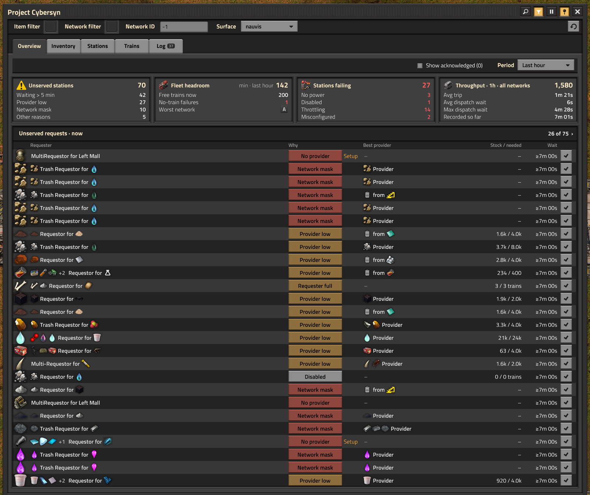
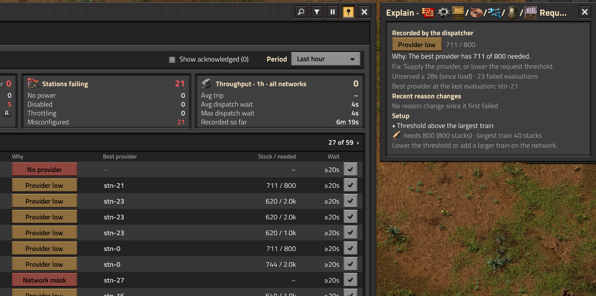
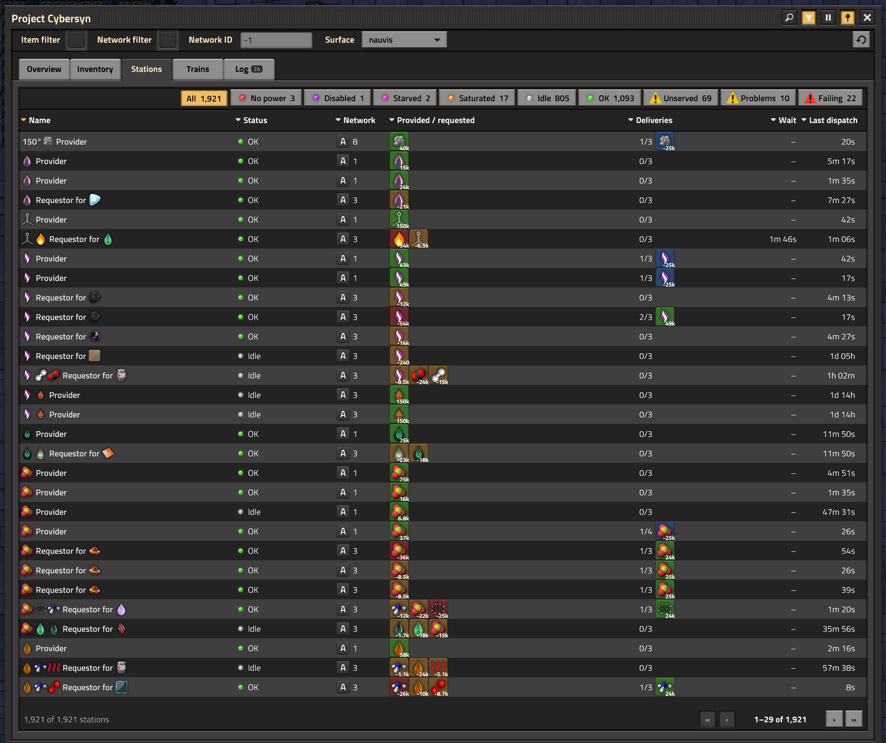
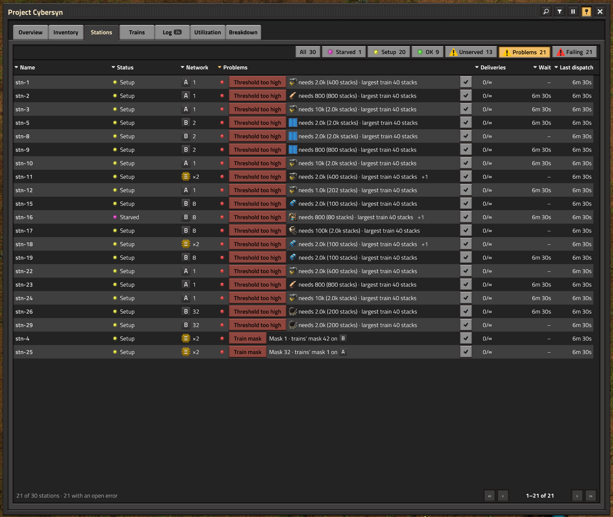
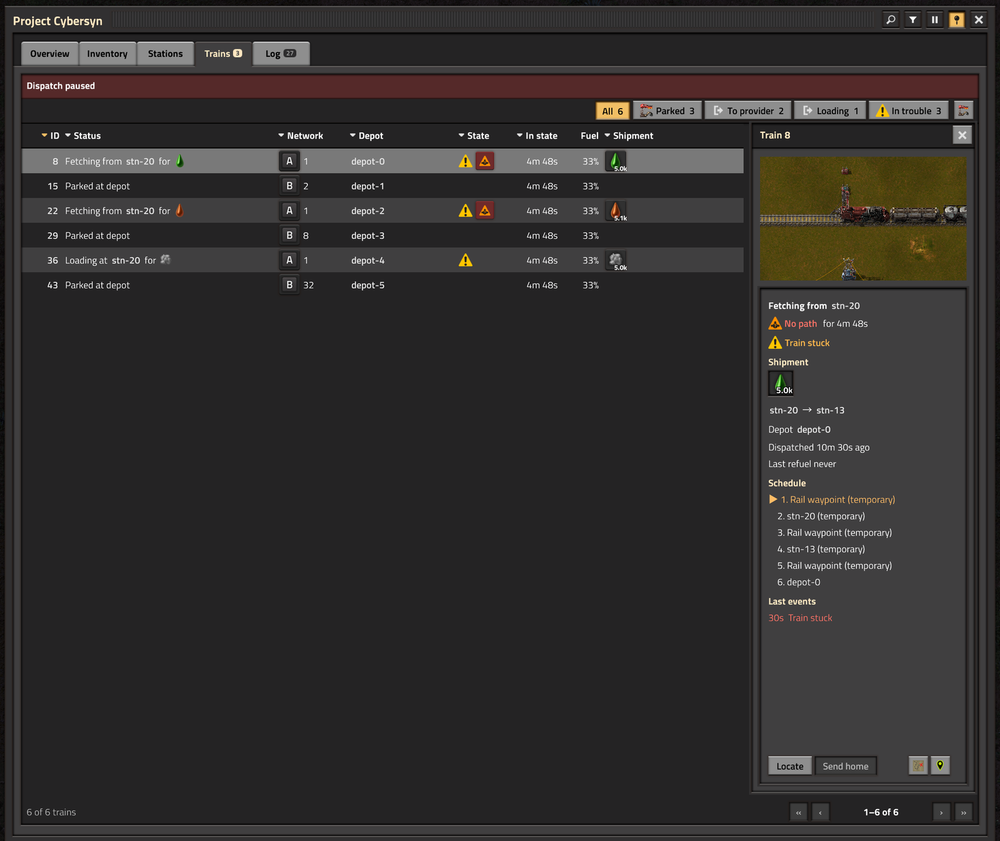
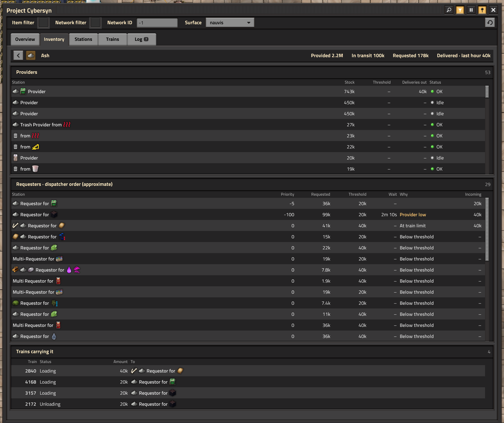
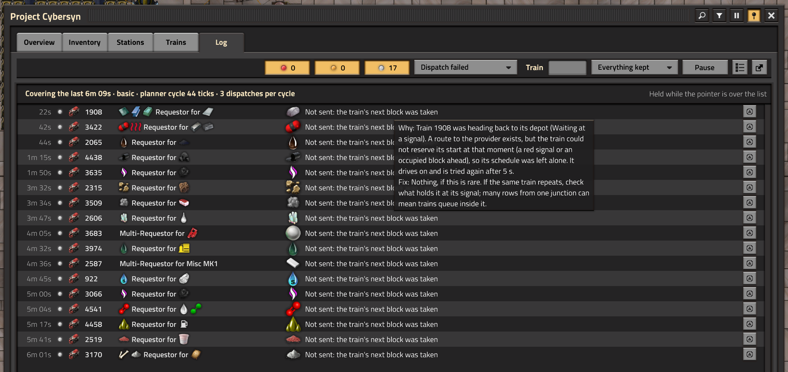
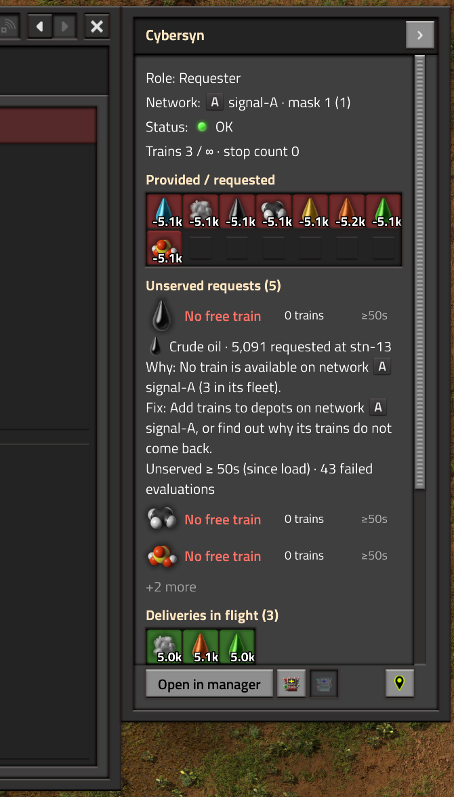
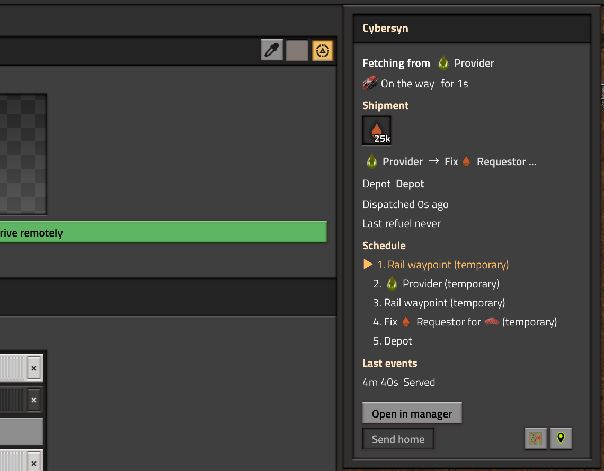

# Project Cybersyn

danbopes's fork of Mami's [Project Cybersyn](https://github.com/mamoniot/project-cybersyn) for Factorio 2.0: a drop-in replacement for the stock mod that adds the [secondary inventory combinator](#the-secondary-inventory-combinator), a rebuilt manager and dispatcher diagnostics. MIT licensed, like the original.

*The Overview on a Pyanodons save with 2,030 stations and 553 trains. Each unserved request names its reason, the best provider and how long it has waited.*

Cybersyn is a train logistics mod. A cybernetic combinator next to a train stop turns it into a provider, a requester or a depot, and a central planner sends trains between them. If you haven't used it before, read [Cybersyn basics](#cybersyn-basics) at the end of this page first. Everything that section describes works the same in this fork.

## Why this fork

Two things, and the first exists only here.

**The secondary inventory combinator.** Stock Cybersyn gives a train stop one inventory, one network mask, one priority and one set of thresholds. This fork adds a combinator mode that lets the same stop publish several inventories, each with its own priority, thresholds and mask, and the planner matches them as separate stops while the train still drives to the one station. It is the fork's main new feature; see [the secondary inventory combinator](#the-secondary-inventory-combinator).

**A manager that holds up at 2,000 stations.** The stock manager window is fine on a small base and falls behind on a large one. Reading its code against a 2,030-station Pyanodons save turned up the same root causes again and again:

- Every tab cleared itself and rebuilt every element once a second, and the Inventory tab called `get_signals` on every station each time. Items jumped around because the grids iterated hash tables, so scroll position and hover reset every second.
- The "Max entities displayed on GUI pages" limit cut the list before sorting it, so a limited list was an arbitrary subset.
- Search was case-sensitive on one tab and not on another, and the item filter compared plain names against keys that carry the quality, so quality items never matched.
- The first tab you saw on opening was empty.

Fixing those one at a time wasn't enough. This fork rebuilds the manager around a snapshot that a collector fills a few stations at a time, and only while someone has the window open. Tabs read the snapshot, sort it deterministically and update rows in place. On that save, with 2,030 stations and 553 trains, every tab's median render stays inside its budget: 5 ms per update, less for the Overview and the Log.

The second half of the work answers a question the stock window doesn't: *why is this request still waiting?* The dispatcher now records a reason every time it fails to serve a request (no provider, provider low, network mask, no free train, train too small, layout, and so on), and setup checks predict which reason a misconfigured stop will produce before you go looking.

None of this is a criticism of upstream. Cybersyn's planner is fast and its design is sound; the manager just wasn't built for this scale. The dispatcher here stays close to Mami's, and the [dispatcher changes](#dispatcher-changes) are listed one by one.

## The secondary inventory combinator

A stock station is one stop with one inventory. Whatever the station combinator's input says it has is provided or requested under one network mask, one priority and one request threshold. To provide iron at low priority but hold a reserve at high priority, or to request on one sub-network and provide on another, you build a second train stop.

This fork adds a sixth combinator mode, **Secondary Inventory**. Place another cybernetic combinator next to the same train stop, where a station control combinator would go, set its mode, and wire its own input. The planner treats it as a stop of its own at that station: its items are matched, prioritised and thresholded separately, and the train still drives to the one stop. A station can carry any number of them.

What a secondary inventory combinator reads from its own input:

- Item and fluid signals. A positive count is provided, a negative count is requested, under the station's provide and request settings; "Stack thresholds" applies as it does for the station.
- **Request threshold**, **Fluid request threshold**, **Priority** and **Reserved fluid capacity**: its own values, with the station's as the default when a signal is absent.
- A signal matching the station's network signal: its own network mask. With the "each" network, each virtual signal is the mask for that network.

What stays with the station: the network signal itself, provide-only or request-only, per-item thresholds from a station control combinator, the train limit, the allow list and the deliveries in flight (every inventory at the stop subtracts the station's deliveries from its count, so a train already on its way counts against all of them). One stop, several entries in the economy. The manager shows a secondary inventory's items inside its station's row and in the inventory totals.

Take a smelter whose stop provides plates to the main network and takes ore from a mining sub-network on a different mask bit. The station combinator carries the plate count and the main mask; a secondary inventory combinator carries the negative ore signal, the mining mask bit and a request threshold of one wagon. One stop, one train limit, two entries in the economy on two networks, where stock Cybersyn needs a second train stop.

## What's in the manager

Open it with **Ctrl+T** or the shortcut bar button "Toggle Cybersyn Manager". The window sizes itself to your screen and shows whole rows. Tabs: **Overview**, **Inventory**, **Stations**, **Trains**, **Log** and **Utilization**, plus **Breakdown** when "Enable delivery breakdown" is on and factorio-charts is installed.

### Overview

Four tiles and one table. **Unserved stations** counts stations with a request the dispatcher isn't serving, broken down by reason for the requests waiting longer than five minutes. **Fleet headroom** is the fewest trains available on any network over the chosen period, with "Free trains now" and the no-train failures below it. **Stations failing** splits into no power, disabled, throttling (a train limit is holding a request back) and misconfigured. **Throughput** covers deliveries, average trip and dispatch wait for the period (last 10 min, last hour or last 24 h).

Clicking a tile lands on the list behind its number, and that list always shows the same count. The **Unserved requests** table below lists each failing request with its *Why* chip, best provider, stock against what is needed, and wait.

Click a Why chip and an **Explain** frame opens beside the window with what the dispatcher recorded, the fix line, the recent reason changes and any setup finding that blocks the request. The tick button at the end of a row acknowledges it: click for 24 h, Shift for 1 h, Ctrl until the reason changes. Acknowledged requests stop counting and leave the table; tick "Show acknowledged" to see them greyed out.

### Stations

One row per station: name with its item icons, status, network, provided and requested items (secondary inventory combinators included), deliveries against the train limit, the oldest request's wait and the time since the last dispatch. Every column sorts from its header. The chips along the top filter by status (No power, Disabled, Warming up, Starved, Setup, Saturated, Idle, OK) and add **Unserved**, **With stuck train**, **Problems** and **Failing**.

### Problems: setup checks

While a manager window is open, a lint pass walks every station and train in small batches and flags configurations that keep a request from ever being served: a threshold no train can carry ("Threshold too high"), an allow list no train fits, a stop with no network bit, a train mask that matches nothing, a depot with a train limit problem, phantom deliveries, trains never refuelled, and more. Turn on the **Problems** chip on the Stations tab to list them worst first, each with its fix. A stop or combinator that doesn't make a working station at all (wrong side, ghost, doubled, derelict) is tracked from build and removal events and listed after the stations. `/cybersyn-find-problems` prints the same list to chat.

A station that would otherwise be OK but has an open error shows the status **Setup** in yellow.

### Trains

Rows show the train ID, what it's doing and where (as a link), network, composition, depot, state, time in that state, last refuel, fuel and shipment. Columns that every listed train shares are hidden and named in the header tooltip. Chips filter by Parked, To provider, Loading, To requester, Unloading, Returning and Refuelling, plus **In interrupt**, **Not refuelled > 1 h**, **In vanilla group**, **In trouble** and **Problems**. "Group by depot" folds the list into one row per depot name with parked, inbound and bypassed counts.

Click a row to open the detail pane on the right: a camera following the train, its shipment, provider and requester, schedule with the active record marked, and its last log events.

### Inventory

Three grids, **Provided**, **In transit** and **Requested**, in the crafting menu's order by default and sortable by amount, stations, wait or deficit. They update in place, and the layout holds still while the pointer is over a grid. "Dim unrequested" greys out items nobody on the same network asks for.

### Item drill-down

Click any item anywhere in the manager or the panels to see everyone who touches it: **Providers** with stock and outgoing deliveries, **Requesters · dispatcher order (approximate)** with priority, threshold, wait and why each one isn't being served, and **Trains carrying it**. Each list scrolls on its own. Shift+click filters the Stations tab by the item instead; right-click clears the item filter.

### Log

The **Log** tab reads the diagnostics log, newest first. It follows new events until the pointer rests on the list or you press **Pause**; **Newest** jumps back. Filter by severity, by kind (Unserved requests, Deliveries, Stations, Trains, Cargo, Setup, Actions), by train ID and by time window (Last 10 min, Last hour, Everything kept). Hovering a row's message explains the cause and what to do about it. **Summary** swaps the rows for the stations and items with the most events. The print button on a row puts it in chat with clickable train, stop and map tags, and the export button writes a CSV (see [Reporting bugs](#reporting-bugs)). The tab badge counts errors since you last looked.

Diagnostics come in three levels set by the map setting "Diagnostics". **Basic**, the default, keeps why each unserved request is waiting plus failures, alerts and station changes in a 4,096-row log. **Full** adds every dispatch, arrival, departure and train state change in a second 16,384-row log. **Off** records nothing and hides the Log tab.

### Stop and train panels

Open a train stop and a **Cybersyn** panel docks to the right of the vanilla window. It shows the stop's role, network and mask, status, deliveries against the train limit, items, unserved requests with their why and fix lines, deliveries in flight, setup findings and the stop's last log events. **Effective config** expands into the numbers the dispatcher really uses: the threshold and where it came from, the stacks it fills, the largest eligible train and the allow list. When no manager window is open, the panel reads the stop live.

A locomotive gets the same treatment: a panel flush with the vanilla train pane that shows what the train is doing, its shipment, depot, schedule and last events. It also carries **Send home**, a path trace that draws the rest of the train's route for 10 s, and a map pin.

 

### Show on map, links, filters

Station, train and item names in every table are buttons. Click to open, Shift to show on the map, Ctrl for the station's combinator, Alt for its control combinator, Ctrl+Shift to drop a map pin. Show on map lands where a map pin would and keeps the manager pinned open with a **Back** button.

The title bar holds search (Ctrl+F; space-separated words, case-insensitive), the filter row (item, network, network ID and surface; closing the row clears them), **Pause** and the pin. A pinned window stays open while you interact with the world, and Escape closes overlays one at a time. Lists page by whole rows, up to "Manager rows per page".

### HUD line

Turn on "Manager: Unserved line on screen" in your per-player settings for a small draggable box that reads "Unserved now" and "Free trains now" plus the most common reason, refreshed every 5 seconds. Clicking it opens the manager.

### Actions and commands

State-changing actions sit where they apply: **Send home** on the train panel and the Trains pane, **Recount deliveries** on a stop whose delivery counter a failed delivery left too high. The console commands `/cybersyn-fix-priorities`, `/cybersyn-abolish-same-depot`, `/cybersyn-recalculate-train-size` and `/cybersyn-refresh-allow-lists` go through the same gate: the map setting "Manager actions allowed for" (Admins by default, or Everyone, or Nobody). Single player is always allowed. Every action is printed to the force and written to the log.

Read-only commands are open to everyone: `/cybersyn-find-problems` and `/cybersyn-reset-gui` (centres the manager and sizes it for your screen again).

## Dispatcher changes

These predate the manager work and are the only changes to how trains get dispatched:

- **Secondary inventory combinator.** The fork's main feature, described in [its own section](#the-secondary-inventory-combinator). Inside the planner it replaced the economy's per-station keys with per-stop records, so two combinators at one station can match different networks.
- **Locked slots scale with the manifest.** A provider's locked slots are reserved per item type, so multi-item deliveries no longer run out of room for the later items.
- **Polling order.** The planner rotates its queue and retires the chosen provider before creating the delivery, whether or not the delivery is then created.
- **Warm-up.** Stations warm up on their own schedule instead of queueing behind the oldest one, and a stop with no connected rail stays in warm-up.
- **Fewer entity writes.** The combinator display is written only when it changes, and item stack sizes are cached at load.
- **Unexpected cargo alert.** Optional, off by default ("Alert for unexpected cargo pickup"): a train that leaves a provider with an item type outside its manifest raises an alert.
- **Quieter alerts and saner recalculation.** The no-train alerts are merged to one per item and network, and `/cybersyn-recalculate-train-size` keeps the layout counts right instead of inflating them on every run.

A golden trace of 176 dispatch events on a fixed test save came out identical after every merge of the manager work, so it hasn't altered dispatching.

## Performance

Three rules shaped the design:

1. **Nothing runs while no window is open**, except bounded counters: the throughput buckets and, unless you turn it off, the diagnostics state.
2. **The collector is incremental.** It reads a slice of stations per update into a snapshot, and only while at least one player has the window open and unpaused. It keeps the snapshot for 2 minutes after the last close so a quick reopen is instant.
3. **Every tab has a per-update budget** on the 2,030-station save: 3 ms for the Overview, 1 ms for the Log, 5 ms for the rest.

Measured on that save (Pyanodons, 2,030 stations, 521 depots, 553 trains), Factorio 2.0.77 headless:

| What | Result |
|---|---|
| Whole game tick, manager closed (`--benchmark`, 1800 ticks, 3 interleaved runs each) | each development round against the one before: -0.056, +0.027, +0.030 ms, inside the 0.1 ms gate; about 6.5 to 6.7 ms per tick overall |
| Manager tick with every window closed | 0.0003 ms per game tick at 1 update/s |
| Basic diagnostics | 0.0087 ms per game tick |
| Render median per manager update, window open | Overview 1.54, Stations 0.78, Trains 0.50, Inventory 0.11, Log 0.34 ms |
| Cold open to first data on the Overview | 12 ticks (the round before: about 606) |
| Item drill-down open on Ash (53 / 29 / 4 rows), steady | median 0.37 ms |
| 3 game-hours with the window open | heap +0.41 %/h (basic), -0.53 %/h (full) |

## Installing

The fork keeps the mod name `cybersyn` and ships as a zip on [GitHub Releases](https://github.com/danbopes/project-cybersyn/releases). It isn't on the mod portal (see [Releases and versioning](#releases-and-versioning)). It needs Factorio 2.0 (base 2.0.60 or newer) and flib 0.15.0 or newer.

1. Back up your save.
2. Open your mods folder: `%APPDATA%\Factorio\mods` on Windows, `~/.factorio/mods` on Linux, `~/Library/Application Support/factorio/mods` on macOS.
3. Remove the stock `cybersyn_2.0.x.zip` from that folder.
4. Put `cybersyn_3.0.0.zip` in the folder. Don't unzip it.
5. Start the game and load your save.

If the game offers to "sync mods with save", say no: that would put back the stock version the save last ran with.

### Upgrading from stock Cybersyn

Because the name is unchanged, Factorio treats the fork as a newer version of the same mod. Everything in the save carries over: stations, depots, refuelers, trains, deliveries in flight, combinator settings and mod settings. On the first tick a one-time conversion in `scripts/fork-migrations.lua` reshapes the stored data. It's written for saves from stock 2.0.53 (the last portal release) and 2.0.54.

What you'll notice: the dispatcher's cycle restarts and every station warms up again, so for the length of "Station warmup time (sec)" no new deliveries start. Trains already on a delivery finish it. Two stock settings are gone: "Track request wait times" (wait tracking is always on now; its cost was too small to measure) and "Max entities displayed on GUI pages" (the window pages by what fits on screen).

Going back to stock Cybersyn with the same save isn't supported. Keep the backup.

### Multiplayer

The server and every player need the same `cybersyn_3.0.0.zip`. Each player's window, filters and settings are their own; the actions gate checks the acting player's admin flag on every peer. Client joins on both test saves were run at every checkpoint without a desync.

### Compatibility

Mods that depend on Cybersyn keep working: cybersyn-combinator, Cybersyn-Content-Reader, the Pyanodons compatibility and anything else that uses the `cybersyn` name, its prototypes, its signals, its setting names or the `cybersyn` remote interface. None of those changed. Space Exploration elevator support is the same as upstream's. The Breakdown tab still needs [factorio-charts](https://mods.factorio.com/mod/factorio-charts).

## Settings this fork adds

Map settings:

- **Diagnostics**: Off, Basic (default) or Full. Basic keeps a 4,096-row log, Full adds a second 16,384-row log. See [Log](#log).
- **Manager actions allowed for**: Admins, Everyone or Nobody.
- **Alert for unexpected cargo pickup**: off by default.

Per player:

- **Manager: Unserved line on screen**: the HUD line, off by default.

The stock "Enable analytics" setting is now called "Enable delivery breakdown": it only records per-delivery timings for the Breakdown tab, which needs factorio-charts. Utilization is always available.

Startup: **Manager test interface** registers the remote interface the automated tests drive. Players don't need it.

## Reporting bugs

Open an issue at [github.com/danbopes/project-cybersyn/issues](https://github.com/danbopes/project-cybersyn/issues). Please don't take fork bugs to upstream's Discord, since most of the code involved only exists here.

Useful attachments, roughly in order:

1. The save, or a smaller one that shows the problem.
2. `factorio-current.log` from the folder above your mods folder (crashes and Lua errors land there).
3. A Log export. On the Log tab, set the filters and window to cover the problem and press the export button at the top right. The file lands in `script-output/cybersyn/diag-<tick>.csv` in your Factorio user data folder; in multiplayer it's written on your machine, or on the server if you leave mid-export.
4. A screenshot of the manager or the stop panel, and the diagnostics level you run.

## Releases and versioning

Releases are zips on [GitHub Releases](https://github.com/danbopes/project-cybersyn/releases). The first one is **3.0.0**. A major version above upstream's 2.0.x makes Factorio see the fork as an upgrade from any stock 2.0 save and keeps the two version lines from ever colliding. Upstream's 2.0.53 is its last portal release; its 2.0.54 only exists in git.

The fork stays off the mod portal for Factorio 2.0 because it can't share the name `cybersyn` there. With Factorio 2.1 it moves to the portal under its own name and uses 2.1's `migrates_from` field in info.json to take over stock Cybersyn saves directly.

Maintainers: the release steps are in [RELEASING.md](RELEASING.md).

## Credits and license

Project Cybersyn is Mami's work: [github.com/mamoniot/project-cybersyn](https://github.com/mamoniot/project-cybersyn), [mod portal page](https://mods.factorio.com/mod/cybersyn). If you like the mod, consider supporting her on [ko-fi](https://ko-fi.com/lesbianmami). The fork includes upstream's later contributions up to 2.0.54, such as the analytics tabs.

The manager's GUI code started from raiguard's LTN Manager; its license is in [cybersyn/scripts/gui/LICENSE](cybersyn/scripts/gui/LICENSE).

MIT license, see [LICENSE](LICENSE).

## Cybersyn basics

This section condenses upstream's quick start and mode reference. Nothing here differs in the fork.

### The example blueprints

[cybersyn_blueprints.txt](cybersyn_blueprints.txt) is a blueprint book string with working examples, from a minimal network to universal stations. Paste its contents into the game's import box.

### Quick start

Think of the network the way you think of robots: requester stations are requester chests, provider stations are passive provider chests, depots are roboports and trains are the bots.

A minimal network needs depots and stations. Both come from a cybernetic combinator placed next to a train stop: set its mode to **Station** or **Depot**. Send a train to the depot and Cybersyn takes it over. Stop names don't matter to Cybersyn.

A station reads its combinator's input circuit. A positive cargo signal means the station provides that cargo; a negative one means it requests it. For a provider, wire a chest or tank buffer beside the tracks to the combinator. For a requester, do the same with the inserters or pumps reversed, then add a constant combinator that outputs the amount to keep in stock as a negative number, plus a **Request threshold** signal no larger than your trains' capacity. Once a provider has what a requester asks for, a train goes. Leave the requester room to unload at least two full trains.

Without thresholds trains will often run part-loaded. The [Request threshold](#request-threshold) section below explains how to fix that.

The combinator has six modes. Station and Depot are the only ones a network needs.

### Station

Provides or requests cargo as described above. When a train arrives, the combinator outputs what it should load (negative) or unload (positive). A station can build an **allow-list** from the inserters and pumps along its tracks so only trains it can actually load or unload get sent; this works with miniloaders. It can also be set to provide only or request only.

### Depot

Any train that parks at a depot joins the network. When an order needs a train with enough capacity that both stations' allow-lists accept, Cybersyn dispatches one. After the delivery the train returns to any stop with its depot's name. A depot's input is only read when a train parks there. With **Depot bypass** a train that has fuel can take its next order without going home first.

### Refueler

After a delivery, a train below the "Fuel threshold" setting looks for a refueler on its network that is under its train limit and accepts it, and detours there before going home. Refuelers can build allow-lists too, which keep out trains that would fill a cargo wagon with fuel.

### Station control

A second combinator at an existing station. Any non-zero cargo signal on its input overrides the station's request threshold for that cargo. On a provider, holding more than that threshold forces a delivery to the next available requester, which is useful for purging unwanted cargo. A **priority** signal on it applies to every cargo it lists, so one station can use two priorities. Its output is the sum of all loading and unloading orders in progress for the station; an order appears the tick its train is dispatched and leaves when the train departs.

### Wagon control

Placed along a station's tracks, it outputs what the parked wagon next to it should load or unload and filters that cargo wagon's slots into sorted order. With a filter inserter, a memory cell and an unloading inserter per wagon you get a loader for any item, and a row of them makes a universal station.

### Secondary inventory

The fork's sixth mode: another inventory at the same stop with its own priority, thresholds and mask. See [the secondary inventory combinator](#the-secondary-inventory-combinator).

### Networks

Every combinator belongs to a network, `signal-A` by default. Networks with different signals share no trains and no cargo. If the combinator's input carries its own network signal, the value is a bitmask of 32 sub-networks, and two stops trade only if their masks share a bit (`mask1 & mask2 > 0`). A cargo signal used as a network ID is read only as the mask. The **each** signal joins a stop to every network whose virtual signal is on its input, using that signal's value as the mask.

With Space Exploration, Cybersyn finds space elevators and routes trains through them between surfaces. Surfaces without an elevator between them need separate networks.

### Request threshold

A request goes out only when the station asks for more than its threshold, some provider on the network holds at least that much, and some train can carry it. High thresholds mean fewer, fuller trains and bigger buffers. The **Request threshold** signal sets it per station; a station control combinator sets it per cargo. With **Stack thresholds** ticked, thresholds count stacks instead of items (fluids are unaffected). There's no provide threshold because the request threshold is enforced at the provider too.

### Locked slots per cargo wagon

The **Locked slots per cargo wagon** signal leaves that many slots empty in each cargo wagon of an order. Multi-item providers need it.

### Priority

Higher **Station priority** wins first, for stations, depots and refuelers. Between equal depots or refuelers the closest wins. Between equal requesters the one served least recently wins, and between equal providers the one closest to the requester; so shortages get round-robin and surpluses get shortest-distance. A provider won't serve a lower-priority requester while a higher one is still waiting.

### Train limits

Cybersyn honours the train stop's own train limit and dispatches no more trains to a stop than it allows, which cuts down on stackers and deadlocks.

When something is misconfigured, Cybersyn raises an alert rather than delivering cargo somewhere it shouldn't go.
